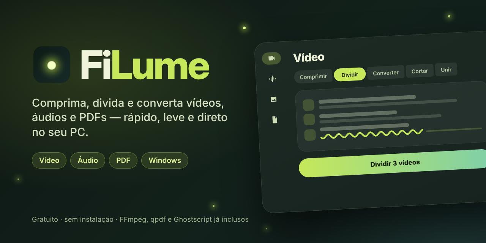

<p align="center">
  
</p>

<p align="center">
  <a href="https://github.com/caua-f-o/FiLume/releases/latest"></a>
  <a href="https://github.com/caua-f-o/FiLume/actions/workflows/build.yml"></a>
  
  
  <a href="https://github.com/caua-f-o/FiLume/releases"></a>
</p>

<p align="center">
  <b><a href="https://github.com/caua-f-o/FiLume/releases/latest">⬇️ Baixar o FiLume para Windows</a></b>
</p>

---

**FiLume** (*file* + *lume*, de vagalume) é um canivete suíço para arquivos de mídia no desktop: comprime, divide, converte, corta e junta vídeos, áudios e PDFs. Tudo roda no seu computador, sem enviar nada para a internet, e funciona com arquivos de muitos GB sem pesar na memória.

Não precisa instalar nada além do próprio FiLume: o FFmpeg, o qpdf e o Ghostscript já vão dentro do pacote.

## Instalação

1. Baixe o **`FiLume-windows-x64.zip`** da [última versão](https://github.com/caua-f-o/FiLume/releases/latest).
2. Extraia em qualquer pasta.
3. Abra o **`FiLume.exe`**.

É portátil: não mexe no registro e pode ficar num pendrive. Para remover, apague a pasta.

## Ferramentas

### 🎬 Vídeo

| Ferramenta | O que faz |
| --- | --- |
| **Comprimir** | Por qualidade, tamanho final (MB) ou porcentagem. H.264, H.265 e AV1, na CPU ou na GPU (NVIDIA, Intel e AMD detectadas sozinhas). Limite de resolução e FPS. |
| **Dividir** | Por tamanho de cada parte, por duração ou em N partes. Sem recodificar: rápido e sem perda. |
| **Converter** | MP4, MKV, MOV ou WebM. Quando os codecs já servem, só troca o contêiner em segundos. |
| **Cortar** | Mantém um trecho. Player embutido para marcar início e fim; modo rápido (sem perda) ou exato. |
| **Unir** | Junta vídeos na ordem da lista. Mesmo formato: sem recodificar. |
| **Recortar** | Por proporção (9:16, 1:1…), por margens ou removendo barras pretas, com prévia ao vivo. |
| **Mux** | Troca, adiciona ou remove áudio e adiciona legendas (.srt, .ass, .vtt) sem recodificar. |

### 🎧 Áudio

| Ferramenta | O que faz |
| --- | --- |
| **Converter** | MP3, M4A, Opus, OGG, FLAC ou WAV. Também extrai o áudio de vídeos. |
| **Comprimir** | Por bitrate, tamanho final ou porcentagem. |
| **Mixar** | Sobrepõe vários áudios (voz + trilha), com volume por faixa. |
| **Dividir** | Por tamanho, duração ou número de partes, sem recodificar. |
| **Unir** | Junta na ordem da lista. |

### 📄 Documentos (PDF)

| Ferramenta | O que faz |
| --- | --- |
| **Comprimir** | Quatro níveis, com opção de tons de cinza. PDFs escaneados chegam a encolher mais de 90%. |
| **Dividir** | A cada N páginas, por tamanho máximo (anexos de e-mail), por intervalos ou página a página. |
| **Unir** | Vários PDFs em um só. |
| **Organizar** | Mesa com miniaturas: arraste, gire, exclua e misture páginas de vários PDFs. |
| **PDF → Imagens** | JPG ou PNG em 72, 150 ou 300 dpi. |
| **Imagens → PDF** | Cada imagem vira uma página, em A4 ou no tamanho original. |
| **Senha** | Protege com AES-256 ou remove a senha (sabendo a atual). |

### 🖼️ Imagem

Em desenvolvimento: conversor, compressor, redimensionador e rotacionador.

## Feito para arquivos grandes

- O app nunca carrega o arquivo na memória: o FFmpeg lê e grava em streaming.
- Uma tarefa por vez na fila, para CPU, RAM e disco ficarem previsíveis.
- **Modo econômico** na compressão: usa metade da CPU para você continuar usando o PC.
- Dividir, cortar, unir, converter e mux evitam recodificar sempre que possível — vídeos de dezenas de GB ficam prontos em segundos.
- Cancelar ou fechar a janela encerra o processo e apaga o arquivo incompleto.

## Para desenvolvedores

O app é Flutter (Material 3) e usa as ferramentas de linha de comando como processos separados.

```
lib/core/      lógica (sem interface): uma ferramenta por arquivo
  ffmpeg.dart      localizar FFmpeg, ler metadados, rodar processos
  compress.dart    split.dart  convert.dart  trim.dart  merge.dart  crop.dart  mux.dart
  audio.dart       ferramentas de áudio
  pdf.dart         ferramentas de PDF · pdf_workspace.dart organizador e miniaturas
  streams.dart     compatibilidade de codecs/contêineres
  state.dart       estado do app e fila de tarefas
lib/ui/        telas
  modules.dart     lista de ferramentas de cada módulo
  expressive.dart  componentes no estilo Material 3 Expressive
tool/
  patch_windows.dart  personaliza o runner do Windows e baixa os motores de PDF
  core_test.dart      teste do núcleo sem interface (roda no CI)
```

**Compilar:** cada push na `main` roda o [GitHub Actions](.github/workflows/build.yml), que gera o runner do Windows, compila, embute FFmpeg/qpdf/Ghostscript e publica uma release quando a versão do `pubspec.yaml` é nova.

**Localmente** (Windows, com Flutter estável instalado):

```
flutter create --platforms=windows --project-name filume --org com.filume .
dart run tool/patch_windows.dart
flutter build windows --release
```

Para apontar para outros binários, use as variáveis `FILUME_FFMPEG_DIR` (pasta com `ffmpeg.exe` e `ffprobe.exe`) e `FILUME_PDF_DIR` (pasta com `qpdf/bin` e `gs/bin`).

## Contribuindo

Achou um bug ou tem uma ideia? Abra uma [issue](https://github.com/caua-f-o/FiLume/issues/new/choose). O histórico de mudanças está no [CHANGELOG](CHANGELOG.md).

## Créditos

Criado por **Cauã F. O.**

O FiLume distribui, como programas separados e sem modificação:

- [FFmpeg](https://ffmpeg.org) — build GPL de [BtbN/FFmpeg-Builds](https://github.com/BtbN/FFmpeg-Builds) (GPL v3)
- [qpdf](https://qpdf.sourceforge.io) (Apache 2.0)
- [Ghostscript](https://www.ghostscript.com) (AGPL v3)

E usa os pacotes Flutter [media_kit](https://github.com/media-kit/media-kit), [window_manager](https://github.com/leanflutter/window_manager), [desktop_drop](https://github.com/MixinNetwork/flutter-plugins) e [file_selector](https://pub.dev/packages/file_selector).
